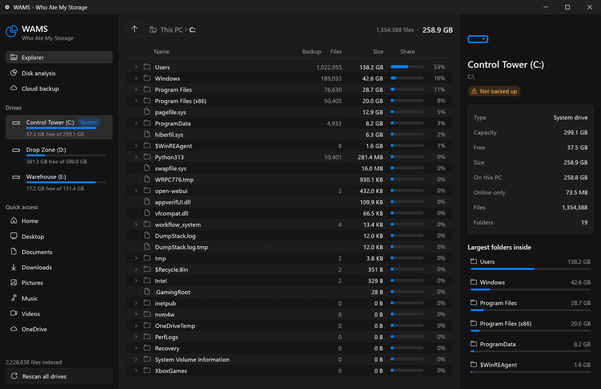
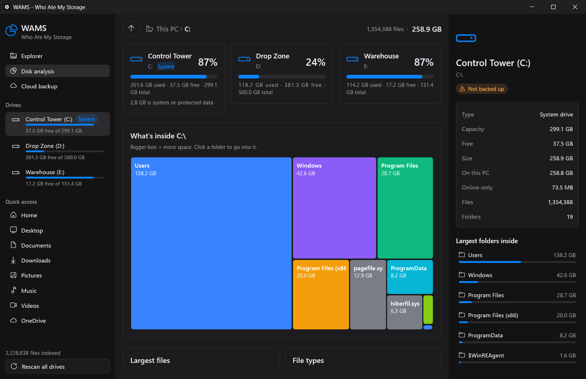

# WAMS: Who Ate My Storage

A small native app for Windows, Linux and macOS (Rust + egui, ~5 MB on Windows) that shows where your disk space went. It has a dark, compact tree explorer (styled after the [Atlas](https://atlasfm.modhyt.org/) file manager) with folder and file sizes, disk analysis, and a cloud backup check.





## Run on any Windows PC

Paste into PowerShell. No admin rights needed:

```powershell
irm https://github.com/codejunction/wams/releases/latest/download/wams.exe -OutFile $env:TEMP\wams.exe; & $env:TEMP\wams.exe
```

The first launch installs WAMS for the current user:

- copies itself to `%LOCALAPPDATA%\Programs\wams\wams.exe`
- starts at login (`HKCU\...\Run`), so a fresh scan is ready after every boot
- shows up in **Settings > Apps**, where you can uninstall it

To try it without installing, run `wams.exe --portable`. To uninstall from the command line, run `wams.exe --uninstall`.

The exe isn't code-signed, so SmartScreen may warn on first run: choose **More info > Run anyway**.

## What you get

- **Explorer**: a tree of every drive with size, file count and share of the parent folder. Breadcrumbs, an up button, and a details pane for whatever you select.
- **Disk analysis**: used/free per drive, how much space is system or protected data WAMS can't read, a treemap of the current folder, the largest files, and space by file type.
- **Cloud backup**: finds the sync folders registered with Windows (OneDrive, Google Drive, Dropbox, iCloud, Box) and marks each folder in your home folder and each known folder (Desktop, Documents, Pictures, …) as **Backed up** or **Not backed up**. Online-only (Files On-Demand) files are counted separately, because they take no space on this PC.
- **Task manager**: who ate my CPU, memory, GPU and disk. Processes are grouped into apps under their human names (the description in the executable, not `msedgewebview2.exe`), each app expands into its sub-tasks, and Windows service hosts are listed by the services they run. Filter to **Apps** or **System**, sort by any column, and **End task** on an app or one sub-task. Ending a system process asks twice. It samples every 1.5 s, only while this view is open.
- **Search**: type in the box above the Explorer list and press Enter to find files and folders by name in the open folder (or every drive from This PC). Results show biggest first, at most 1,000. The Task manager box filters apps and sub-tasks as you type, by name or program path.
- **Drive tags**: drives are tagged **System**, **Local**, **USB**, **Network** or **Cloud**. Network and virtual cloud drives are listed with their capacity but not scanned. Clicking one opens it in Windows Explorer.
- Dark theme with a blue accent, dense zebra-striped rows and monochrome icons. Uses the system Segoe UI and Segoe Fluent Icons fonts.

## Usage

- **Click** a row to select it. Click the arrow to expand or collapse a folder.
- **Double-click** a folder to open it, or a file to show it in Windows Explorer.
- **Right-click** any row: Open, Show in Explorer, Copy path.
- **Rescan all drives** (bottom left) rescans everything.

## Notes

- Sizes are logical file sizes. Symlinks and junctions are skipped, so nothing is counted twice.
- Without admin rights some protected folders can't be read. Disk analysis shows how much space that is per drive.
- Task manager: the Disk column is bytes read and written per second as the kernel counts them, so pipe and network traffic is included. Without admin rights, processes of other users and protected system processes can't be ended. On macOS there is no per-process GPU figure.

## Build

```sh
cargo build --release   # target/release/wams.exe, or target/release/wams on Linux and macOS
cargo test
cargo run -- --portable # Windows: run without installing
```

The same source builds on all three systems. Only Windows has the self-installer; on Linux and macOS the binary runs where it is.

## Linux and macOS

| | Windows | Linux | macOS |
|---|---|---|---|
| Drives | every drive letter | every filesystem on a block device in `/proc/self/mounts`; `/media` mounts are tagged USB | `/` and every volume in `/Volumes` |
| Scan stays on one drive | yes | yes, like `du -x`: `/proc`, `/sys`, tmpfs and other mounts are not counted into `/` | yes |
| Known folders | registry | XDG user folders (`~/.config/user-dirs.dirs`) | `~/Desktop`, `~/Movies`, … |
| Cloud folders | folders registered with Windows | `~/Dropbox`, `~/OneDrive`, `~/Google Drive`, `~/Nextcloud`, `~/ownCloud`, `~/pCloudDrive`, `~/MEGA`, `~/Insync` if they exist | iCloud Drive and `~/Library/CloudStorage` |
| Online-only files | detected | none exist | detected |
| App names in Task manager | description in the executable | name from the app's `.desktop` file | `.app` bundle name |
| "System" in Task manager | runs from the Windows folder, or protected | runs as another user (root, service accounts) | runs from `/System`, `/usr`, `/bin`, `/sbin` |
| GPU per process | yes | no | no |

Linux needs the usual desktop libraries at run time: OpenGL, `libxkbcommon`, and either Wayland or X11 (with `libxkbcommon-x11`). No extra packages are needed to build.

Tested: Windows 11, and Ubuntu 24.04 under WSLg (tests and the app itself). macOS is only compile-checked (`cargo check --target aarch64-apple-darwin`), not yet run on a Mac.
