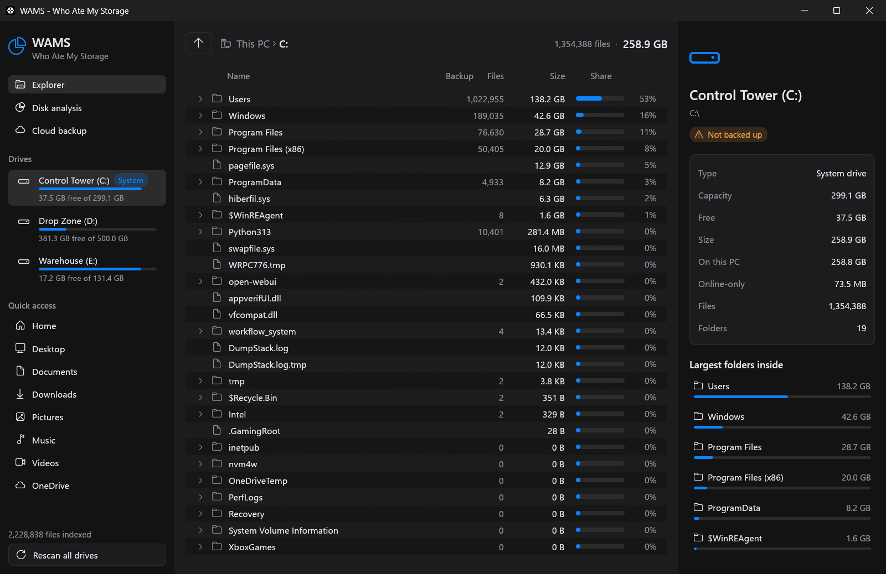
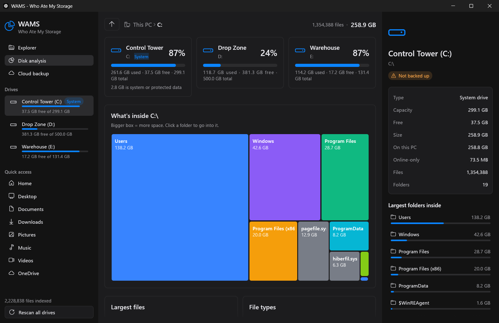

# WAMS: Who Ate My Storage

A small native Windows app (Rust + egui, ~5 MB) that shows where your disk space went. It has a dark, compact tree explorer (styled after the [Atlas](https://atlasfm.modhyt.org/) file manager) with folder and file sizes, disk analysis, and a cloud backup check.





## Run on any Windows PC

Paste into PowerShell. No admin rights needed:

```powershell
irm https://github.com/codejunction/wams/releases/latest/download/wams.exe -OutFile $env:TEMP\wams.exe; & $env:TEMP\wams.exe
```

The first launch installs WAMS for the current user:

- copies itself to `%LOCALAPPDATA%\Programs\wams\wams.exe`
- starts at login (`HKCU\...\Run`), so a fresh scan is ready after every boot
- shows up in **Settings > Apps**, where you can uninstall it

To try it without installing, run `wams.exe --portable`. To uninstall from the command line, run `wams.exe --uninstall`.

The exe isn't code-signed, so SmartScreen may warn on first run: choose **More info > Run anyway**.

## What you get

- **Explorer**: a tree of every drive with size, file count and share of the parent folder. Breadcrumbs, an up button, and a details pane for whatever you select.
- **Disk analysis**: used/free per drive, how much space is system or protected data WAMS can't read, a treemap of the current folder, the largest files, and space by file type.
- **Cloud backup**: finds the sync folders registered with Windows (OneDrive, Google Drive, Dropbox, iCloud, Box) and marks each folder in your home folder and each known folder (Desktop, Documents, Pictures, …) as **Backed up** or **Not backed up**. Online-only (Files On-Demand) files are counted separately, because they take no space on this PC.
- **Drive tags**: drives are tagged **System**, **Local**, **USB**, **Network** or **Cloud**. Network and virtual cloud drives are listed with their capacity but not scanned. Clicking one opens it in Windows Explorer.
- Dark theme with a blue accent, dense zebra-striped rows and monochrome icons. Uses the system Segoe UI and Segoe Fluent Icons fonts.

## Usage

- **Click** a row to select it. Click the arrow to expand or collapse a folder.
- **Double-click** a folder to open it, or a file to show it in Windows Explorer.
- **Right-click** any row: Open, Show in Explorer, Copy path.
- **Rescan all drives** (bottom left) rescans everything.

## Notes

- Sizes are logical file sizes. Symlinks and junctions are skipped, so nothing is counted twice.
- Without admin rights some protected folders can't be read. Disk analysis shows how much space that is per drive.

## Build

```sh
cargo build --release   # target/release/wams.exe
cargo test
cargo run -- --portable # run without installing
```

macOS (experimental, not tested on a Mac yet): `cargo build --release` on a Mac. It scans `/` and every volume in `/Volumes`, and reads iCloud Drive and `~/Library/CloudStorage` sync folders.
